# Ambinder.A2A SDK architecture

Date: 2026-11-03. Status: draft, derived from the SDK specs.

This page shows how the Ambinder.A2A .NET SDK fits together. It is for product teams that adopt the SDK, for contributors, and for the builder. It adds no decisions. Every fact comes from the work plan [00] and the 16 package specs (01 to 16). Where the specs disagreed or were silent, the points were resolved and are listed under [Resolved during architecture review](#10-resolved-during-architecture-review).

Spec links: [00] work plan, [01] packaging, [02] public API, [03] conformance, [04] card signing, [05] stores, [06] cluster, [07] security, [08] push, [09] hosting, [10] client, [11] authoring and AI, [12] testing, [13] docs, [14] performance, [15] 0.3 compat, [16] interop.

## 1. Overview and principles

The SDK lets .NET teams build A2A agents (server) and call A2A agents (client) in production. It targets A2A v1.0.1 and .NET 10 only. Package IDs and namespaces are `Ambinder.A2A.*`, because the NuGet ID `A2A` belongs to the official SDK [00].

Every package must meet six principles [00]:

1. **Follows the A2A protocol.** The official TCK passes every MUST and SHOULD on JSON-RPC, HTTP+JSON and gRPC, in CI on every PR.
2. **An enabler for .NET developers.** `Add…()` and Options, `ILogger`, `IHttpClientFactory`, OpenTelemetry, Microsoft.Extensions.AI, nullable and XML docs.
3. **Easy to use.** An agent in about 20 lines, a client call in about 5, safe defaults, every error says what to do.
4. **Performance efficient.** Source-generated JSON, pooled buffers, no whole-body buffering, benchmarks in CI with budgets.
5. **Modular and extendable.** Small packages, every seam an interface with a default, server middleware, client interceptors, an extension framework, no Azure or database in the core.
6. **Takes on known A2A integration pains**, so teams do not each solve them again.

Two milestones [00]:

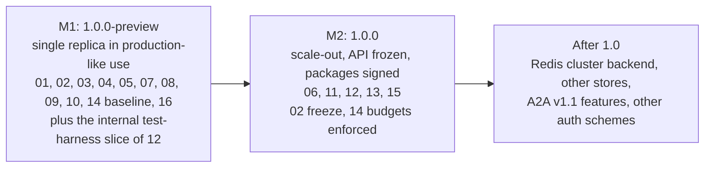

- **M1 exit:** the TCK passes, interop with Python, JS and Java passes, benchmarks have a baseline, previews ship unsigned. M1 deployments are single-replica only: "do not scale out before 1.0" (B1).
- **M2 exit:** 3 replicas on `kind` (and AKS when secrets exist), 0.3 peers work, docs site is live, public API frozen, packages signed.
- Live Entra, Key Vault, Cosmos and AKS tests run only when their secrets exist and are skipped visibly otherwise (O3).

## 2. Layers and package map

Packages form layers. An arrow means "may depend on". Each layer depends only on layers below it. Bridges and infrastructure plug-ins sit side by side and do not depend on each other. The package IDs are exactly those of the package map in [01]. The table below gives each package's direct dependencies.

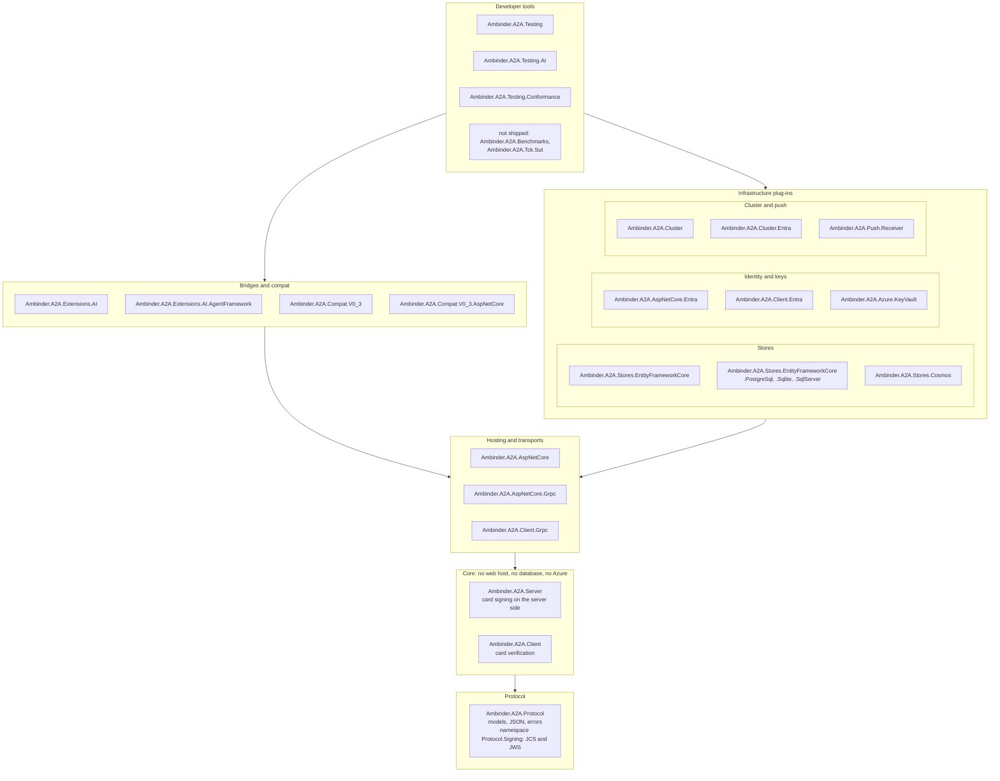

There is no separate card-signing package. JCS and JWS primitives live in `Ambinder.A2A.Protocol` (namespace `Ambinder.A2A.Protocol.Signing`), signing in Server, verification in Client. Only the Key Vault key source is its own package [01], [04].

| Package | Layer | Depends on (our packages) | Owner spec | AOT | Milestone |
|---|---|---|---|---|---|
| `Ambinder.A2A.Protocol` | Protocol | none (no package dependencies) | [03], [04] | yes | M1 |
| `Ambinder.A2A.Server` | Core | Protocol | [05], [06], [07], [08], [09], [11] | yes | M1 |
| `Ambinder.A2A.Client` | Core | Protocol | [10] | yes | M1 |
| `Ambinder.A2A.AspNetCore` | Hosting | Server | [03], [08], [09] | yes | M1 |
| `Ambinder.A2A.AspNetCore.Grpc` | Hosting | AspNetCore | [03], [09] | no (until proven) | M1 |
| `Ambinder.A2A.Client.Grpc` | Hosting | Client | [10] | no (until proven) | M1 |
| `Ambinder.A2A.AspNetCore.Entra` | Infrastructure | AspNetCore, Client.Entra | [07] | no | M1 |
| `Ambinder.A2A.Client.Entra` | Infrastructure | Client | [07] | no | M1 |
| `Ambinder.A2A.Azure.KeyVault` | Infrastructure | Server | [04] (push part: [08]) | no | M1 |
| `Ambinder.A2A.Stores.EntityFrameworkCore` | Infrastructure | Server | [05] | no | M1 |
| `Ambinder.A2A.Stores.EntityFrameworkCore.PostgreSql` | Infrastructure | Stores.EntityFrameworkCore | [05] | no | M1 |
| `Ambinder.A2A.Stores.EntityFrameworkCore.Sqlite` | Infrastructure | Stores.EntityFrameworkCore | [05] | no | M1 |
| `Ambinder.A2A.Stores.EntityFrameworkCore.SqlServer` | Infrastructure | Stores.EntityFrameworkCore | [05] | no | M1 |
| `Ambinder.A2A.Stores.Cosmos` | Infrastructure | Server | [05] | no | M1 |
| `Ambinder.A2A.Push.Receiver` | Infrastructure | Client (no Server, no AspNetCore) | [08] | no | M1 |
| `Ambinder.A2A.Cluster` | Infrastructure | Server, AspNetCore | [06] | no | M2 |
| `Ambinder.A2A.Cluster.Entra` | Infrastructure | Cluster, AspNetCore.Entra, Client.Entra | [06] | no | M2 |
| `Ambinder.A2A.Extensions.AI` | Bridges | Server, Client | [11] | yes | M2 |
| `Ambinder.A2A.Extensions.AI.AgentFramework` | Bridges | Extensions.AI | [11] | no | M2 (preview if not GA, C12) |
| `Ambinder.A2A.Compat.V0_3` | Bridges | Client | [15] | yes for JSON-RPC and REST | M2 |
| `Ambinder.A2A.Compat.V0_3.AspNetCore` | Bridges | Compat.V0_3, AspNetCore | [15] | yes for JSON-RPC and REST | M2 |
| `Ambinder.A2A.Testing` | Tools | Server, Client, Protocol, AspNetCore | [12] | no | M2 (internal slice in M1, B2) |
| `Ambinder.A2A.Testing.AI` | Tools | Testing, Extensions.AI | [12] | no | M2 |
| `Ambinder.A2A.Testing.Conformance` | Tools | Testing | [12] (cases: [05]) | no | M2 |

A server installs one package (`Ambinder.A2A.AspNetCore`), a client one (`Ambinder.A2A.Client`) [01].

Dependency rules [01], [02]:

- **Core means no host.** `Protocol`, `Server` and `Client` reference no ASP.NET Core, gRPC, Azure, EF or database package. `Protocol` has no package dependencies at all.
- **Allow-list test.** CI compares each `.nupkg` with `eng/package-dependencies.json`. A new dependency must be added to that file in the same PR.
- **No `InternalsVisibleTo` between shipped assemblies.** Only to the matching test assemblies and to `Ambinder.A2A.Benchmarks`.
- **Shared code is shared by source.** Small helpers (page tokens, task state rules, request validation) live in `src/Shared/`, and the gRPC proto and mapper in `src/Grpc.Shared/`. Each package compiles them as `internal` (B12). Hot paths use the public typed `JsonTypeInfo<T>` accessors on `A2AJson`.
- **gRPC is opt-in.** A card that offers only gRPC gives an error that names the package to add.
- **No foreign types in public signatures**, except in the bridge packages (`PublicSurfaceTests`) [02].
- **Ranges, not pins.** Our packages depend on each other with `>=` ranges. All packages share one version (MinVer, tag `vX.Y.Z`).
- The core has no 0.3 names (a purity test, [15]) and does not reference `Ambinder.A2A.Cluster` [06].

## 3. Extension points

Every infrastructure seam is an interface with a default [00]. After 1.0, new members on these interfaces get a default implementation, or come as a new interface [02].

| Interface or seam | Package | Purpose | Default | Spec |
|---|---|---|---|---|
| `ITaskStore`, `IPushConfigStore`, `IOutboxStore`, `IInstanceStore` | Server | Tasks, push configs, outbox rows, instance leases | Bounded in-memory stores; EF Core and Cosmos packages | [05] |
| `ITaskWriteContributor` | Server | Add outbox rows in the same write as the task | `PushOutboxContributor` (push) | [05], [08] |
| `IStoreHealthProbe` | Server | Store readiness | EF and Cosmos stores implement it | [05], [09] |
| `ITaskEventBus` | Server | Live events of a task | Local broker (internal) | [06] |
| `ITaskRouter` | Server | Decide where an operation runs | `LocalTaskRouter`; `ClusterTaskRouter` in Cluster | [06] |
| `ITaskForwarder` | Server | Run an operation on another pod | Not registered; `HttpTaskForwarder` in Cluster | [06] |
| `IClusterPeerAuthentication` | Cluster | Pod-to-pod credentials | Entra workload identity (`Cluster.Entra`) | [06] |
| `IOwnerResolver` | Server | Caller to owner key | `DefaultOwnerResolver` | [07] |
| `ITenantResolver` | Server | Trusted A2A tenant | `DefaultTenantResolver` | [07] |
| `ITaskContinuationPolicy` | Server | Who may continue an interrupted task | Owner, or a grant holder for `AUTH_REQUIRED` | [07] |
| `ISecurityRequirementEvaluator` | Server | Check one card security scheme | `openIdConnect` built in; Entra evaluator in `AspNetCore.Entra` | [07] |
| `ISkillAuthorizer` | Server | Per-skill authorization | Card skill requirements | [07] |
| `IAgentCardSigningKeySource`, `A2ASigningKey` | Protocol | Card signing keys | Local or development key; Key Vault package | [04] |
| `IAgentCardVerifier` | Client | Verify card signatures | Policy `IfPresent` | [04], [10] |
| `IPushSigningKeySource` | Server | Push signature keys and JWKS | Ephemeral in Development; local keys; Key Vault | [08] |
| `IPushPayloadFormatter` | Server | Webhook body per protocol version | 1.0 `StreamResponse`; 0.3 formatter in compat | [08], [15] |
| `IPushCredentialProtector` | Server | Protect push credentials at rest | Data Protection (AspNetCore); pass-through in the core | [08] |
| `IPushRequestAuthenticator` | Server | Computed webhook credentials | No-op | [08] |
| `IPushDeadLetters` | Server | List, requeue, purge dead letters | Outbox-backed | [08] |
| `IPushSubscriptionRegistry`, `IPushDeduplicator`, `IPushBodyConverter` | Push.Receiver | Receiver task match, dedupe, legacy bodies | In-memory registry and LRU dedupe; no converter | [08], [15] |
| `IA2APushWaiter`, `PushSubscription` | Client | Wait for a task by push | Implemented by Push.Receiver | [10], [08] |
| `IA2AMiddleware` | Server | Pipeline around every operation | Tracing, limits, auth checks, extensions | [09] |
| Per-request card factory (`AgentCardRequest`, `CardVariesBy`) | Server | Cards per host, tenant or caller | Static card | [09] |
| `IAgentCardContributor` | Server | Add members to card JSON | None in core; Entra, push, extensions, compat add some | [03] |
| `IA2AVersionDispatcher` | AspNetCore | Serve other protocol versions | None; 0.3 in `Compat.V0_3.AspNetCore` | [03], [15] |
| `IGrpcAgentRouter` | AspNetCore.Grpc | Pick the agent for a gRPC call | `Auto`: one agent, else `Tenant` | [09] |
| `IA2AShutdownParticipant` | Server | Steps in graceful shutdown | Cluster adds its steps | [09], [06] |
| `IAgentHandler`, `IAgentEventSink` | Server | Agent logic | Helpers: `TaskUpdater`, delegate agents | [11] |
| `A2AExtension` | Server | A2A extensions: card entry, request and outgoing hooks | None | [11] |
| `IA2AInterceptor` | Client | Before and after every call | None | [10] |
| `IA2ACredentialProvider` | Client | Auth headers per attempt | `DelegateCredentialProvider`; Entra providers | [10], [07] |
| `IA2ATransportFactory`, `IA2ATransport` | Client | Wire transports | JSON-RPC and REST; gRPC and 0.3 as add-ons | [10] |
| `IAgentCardReader` | Client | Parse card JSON into a 1.0 card | 1.0 reader; 0.3 reader in compat | [10], [15] |
| `IA2AAuthRequiredHandler`, `IA2AInputRequiredHandler` | Client | Step-up and input during a wait | None: the wait returns | [10] |

Where the seams plug in:

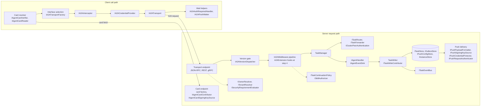

## 4. Server request flow

All three transports and in-process calls go through one `A2APipelineRequestHandler`. No transport calls `TaskManager` directly [09]. The order below follows [09] section 7.11, [07] and [03].

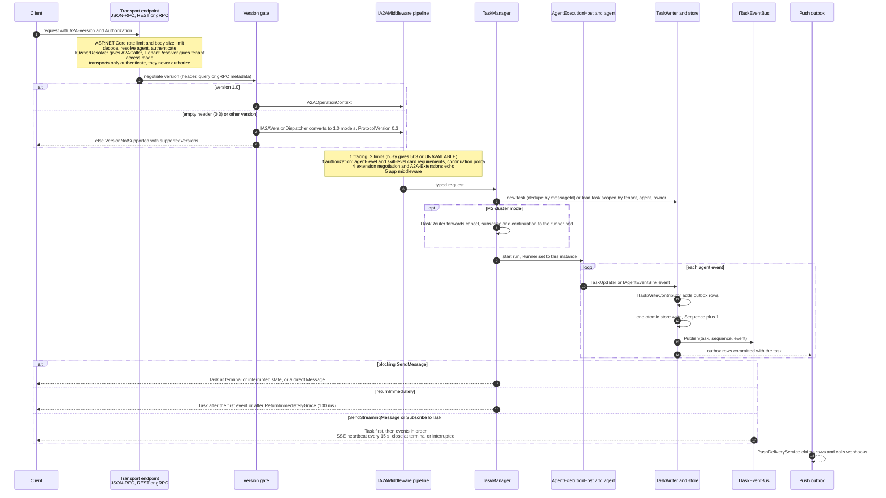

Key rules:

- **Blocking** `SendMessage` waits until a terminal or interrupted state, as the spec requires. `MaxBlockingWait` can cap it, but it is off by default because it deviates from the spec [09].
- **Non-blocking** (`returnImmediately`) returns within `ReturnImmediatelyGrace` (default 100 ms). With no agent event yet, the task is returned as `SUBMITTED` [11].
- **Streaming** sends the task first, then events in order, and closes at a terminal or interrupted state. SSE sends a comment heartbeat at least every 15 s, also before the first event [09].
- **Errors** carry `google.rpc.ErrorInfo` on every transport [03]. An `A2AException` from the agent before its first event fails the call and stores nothing. After that, the task ends `FAILED` [11].
- **Authorization** runs in the pipeline (step 3), not in the transport. Transports authenticate and build the caller only, so the checks are the same on every transport and in-process [07], [09].
- **Rate-limit key** is computed in ASP.NET Core before the body is read, from token claims only: tenant id plus app id (app-only) or user object id (delegated), the same claims `OwnerKey` uses. Anonymous requests partition by client IP. It does not wait for `A2ACaller` [09], [07].
- **Early rejections** (authentication failure, `VersionNotSupported`) never reach the pipeline, so they get no `a2a.server` span. They appear only as the ASP.NET Core request span with its HTTP status, enriched with `error.type` when telemetry is on [03], [09].
- **Overload**: busy gives HTTP 503 with `Retry-After` and reason `SERVER_BUSY`; rate limits give 429 with `RATE_LIMITED` [09].
- **Agent runs** live in `AgentExecutionHost`, not in the request. Each execution and each cancel gets its own DI scope. `HttpContext` is null in agent code [09], [11].

## 5. Client call flow

`IA2AClient` is the only client the SDK hands out. Tracing, interceptors, resilience, limits and auth always apply [10].

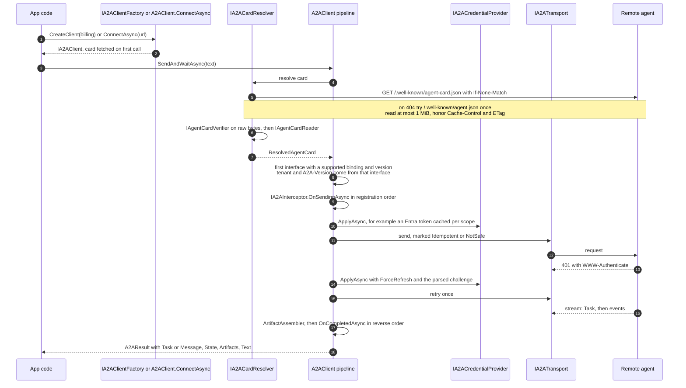

Resilience rules [10]:

- Idempotent operations (GetTask, ListTasks, CancelTask, push-config operations, card fetch) retry 3 times with jitter and honor `Retry-After`. A circuit breaker works per named client.
- `SendMessage` is never resent after bytes were sent, unless `AllowSendRetry` is set (C11). Then only a new-task send is resent, with the same `messageId`. Our servers dedupe it by `(tenant, agent, owner, messageId)` [05].
- `SERVER_BUSY` and `RATE_LIMITED` are retry-safe for every operation. `SERVER_SHUTTING_DOWN`, `TASK_STREAM_INTERRUPTED` and `SUBSCRIBER_TOO_SLOW` trigger a resubscribe, not a resend.
- Per-operation timeouts replace the 100 s `HttpClient` default: 30 s unary, 10 min blocking send, 5 min stream idle, 30 min total wait.
- Reads are bounded: 8 MiB unary body, 4 MiB SSE event, 8 MiB gRPC message, 1 MiB card.

Waiting for completion [10]:

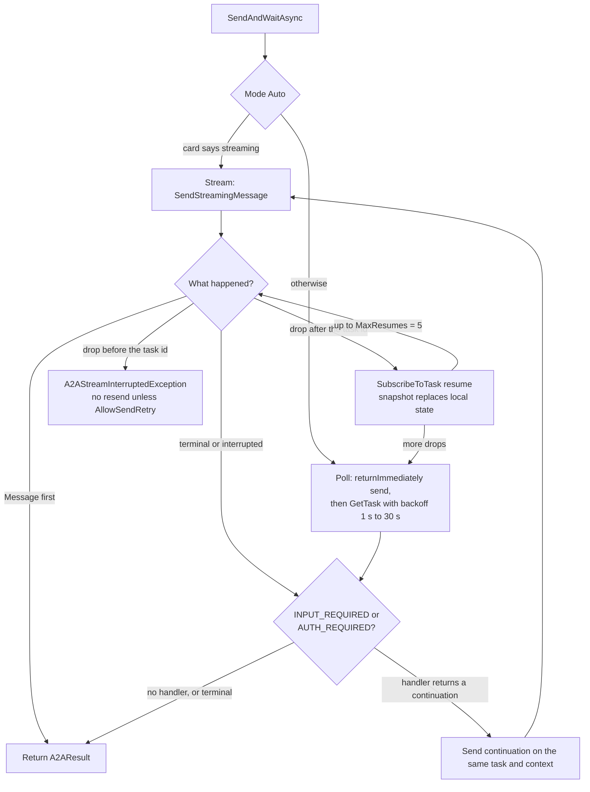

- `Push` mode needs `PushWebhookUrl` and an `IA2APushWaiter` (implemented by `Ambinder.A2A.Push.Receiver`), and it still polls as a safety net. `Blocking` mode is one blocking send.
- `CancelRemoteOnCallerCancel` and `CancelRemoteOnTimeout` default to false (C11).
- `A2AConversation` keeps `ContextId` and the open `TaskId` across turns. The server mints all ids. The task id is cleared on a terminal state [10].
- After a step-up continuation, the wait stays on the continuation's own stream. A later resubscribe or poll uses the original caller's credentials (B6).
- The extended card is cached per credential identity, never across identities (B11).

## 6. Task lifecycle and events

Task states and who triggers each transition [11], [07], [09], [06]:

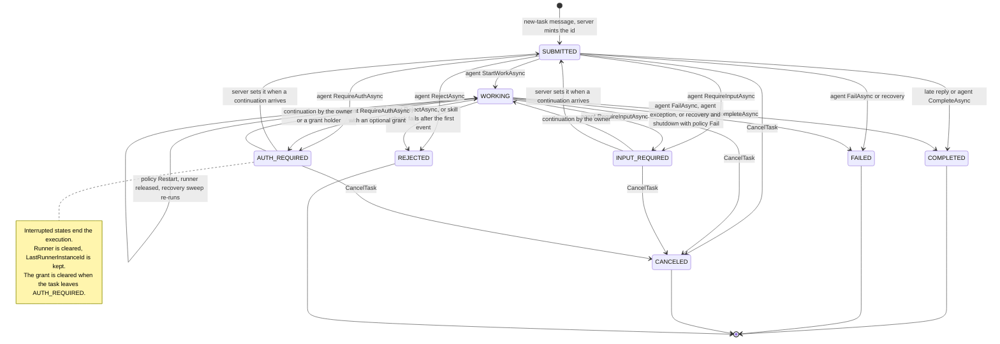

The full table of allowed transitions, with who may trigger each, is in [03] section D13 (the spec-conformance package owns `TaskStateRules`):

| From | Allowed to | Who |
|---|---|---|
| `SUBMITTED` | `WORKING`, `INPUT_REQUIRED`, `AUTH_REQUIRED`, terminal states | agent; `CANCELED` by cancel; `FAILED` by recovery |
| `WORKING` | `WORKING`, `INPUT_REQUIRED`, `AUTH_REQUIRED`, terminal states | agent; `CANCELED` by cancel; `FAILED` by recovery |
| `INPUT_REQUIRED`, `AUTH_REQUIRED` | `SUBMITTED`, `WORKING` (on continuation), `CANCELED` | server on a continuation (`AUTH_REQUIRED` only for callers the continuation policy allows); cancel |
| `COMPLETED`, `FAILED`, `REJECTED`, `CANCELED` | none | terminal states are final |

The agent never sets `SUBMITTED`; the server does [03], [11].

- **Agent** transitions go through `TaskUpdater` or the raw sink. A reply (`ReplyAsync`) creates no task [11]. With `returnImmediately`, a late reply moves a `SUBMITTED` task to `COMPLETED`.
- **Cancel** always ends in `CANCELED`, even if the agent ignores the token. Cancel of a `CANCELED` task returns it; cancel of another terminal state is `TaskNotCancelable` [11].
- **Recovery** applies the agent's policy: `Fail` (default) or `Restart(n)` (opt-in, `[IdempotentAgent]` gives `Restart(1)`) (C10) [09].
- **Limits**: `MaxArtifactBytesPerTask` fails the task as `InvalidAgentResponse` [09].
- A follow-up on a terminal task is `UnsupportedOperation`; the client starts a new task in the same context [03].
- Finished tasks are deleted after `TerminalTaskTtl` (30 days on durable stores, 1 h in memory). Interrupted tasks expire after `InterruptedTaskTtl` (C5) [05].
- Unknown states from newer agents read as `Unspecified` on the client. They are neither terminal nor interrupted, so a wait goes on [03].

How events fan out [05], [06], [08]:

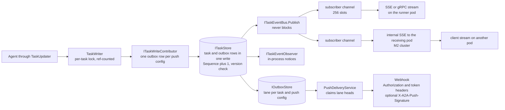

Ordering guarantees:

- Every committed event gets the task's next `Sequence`. The event is saved before it is published, so a resubscribe snapshot matches the live stream [05].
- `SubscribeToTask` registers before it takes the snapshot, under the task lock. The client gets the snapshot, then every later event, with no gap or duplicate [06].
- `Publish` never waits. A full subscriber channel drops only that subscriber, with reason `SUBSCRIBER_TOO_SLOW`. Other subscribers are not slowed [06].
- A cross-pod proxy checks that `Sequence` goes up by one. A gap ends the stream with `TASK_STREAM_INTERRUPTED`, so the client resubscribes [06].
- Push is at-least-once. Each push config is its own lane, delivered in event order. A failing webhook never delays other configs. After the retry budget, the row is dead-lettered and the lane moves on [08].
- There is no replay of missed events (`Last-Event-ID`). The spec defines none. Recovery is a resubscribe with a fresh snapshot [05], [06].

## 7. Deployment on AKS

The SDK does not depend on AKS or Kubernetes APIs. AKS is the tested target [00], [09]. The sample is in `deploy/aks/` (Kustomize).

**M1: one replica.** The base runs 1 replica with `strategy: Recreate` (B1). Graceful shutdown and crash recovery already work on one pod [09].

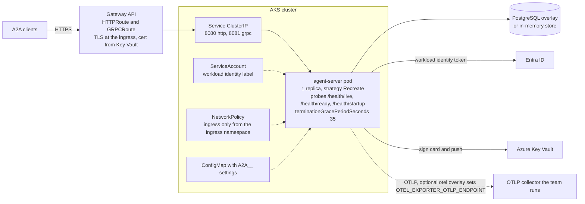

- The pod listens on 8080 and 8081. Public URLs come from `PublicBaseUrl` and `PublicUrls`, never from the bind ports. gRPC serves all agents on one port and picks the agent by the interface `tenant` or by host [09].
- TLS mode `TerminatedAtProxy` needs trusted forwarded headers and turns on HSTS. Mode `None` fails startup outside Development [09].
- Shutdown: drain 5 s, grace 20 s, then `Fail` or release per agent policy. A restarted pod's recovery sweep handles the previous process's tasks within 30 s [09].
- An NGINX ingress variant is documented, with long read timeouts and buffering off for SSE and gRPC (C10).
- OTLP: the SDK does not ship a collector. The optional `overlays/otel/` sets `OTEL_EXPORTER_OTLP_ENDPOINT` to a collector the team runs, and the production docs page points to it [09], [13].
- Data Protection keys are not needed in M1 (single replica) [09], [08].
- Stores: PostgreSQL is the primary durable store. Cosmos DB is supported, but not for cluster mode in 1.0 (B3) [05].

**M2: several pods with owner-pod forwarding.** `AddA2ACluster()` with the EF Core store and Entra pod authentication [06].

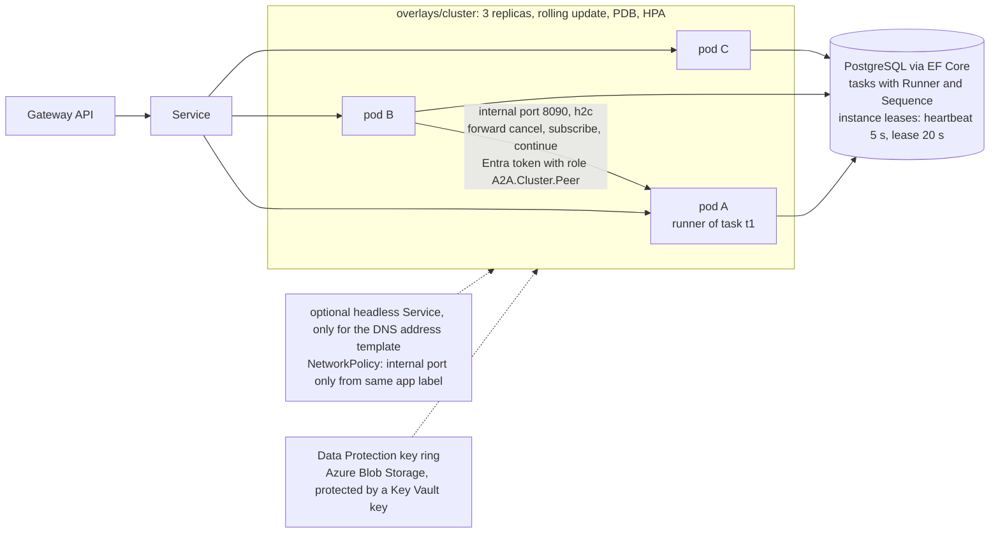

A subscribe that lands on a pod that does not run the task:

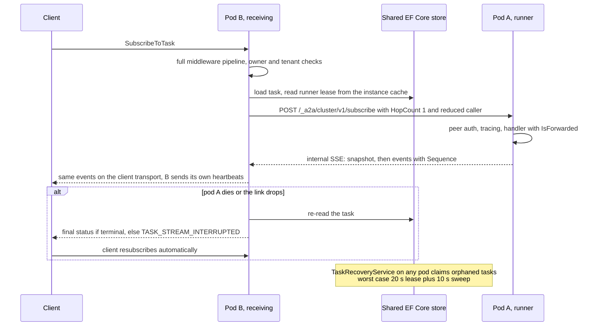

- Reads (`GetTask`, `ListTasks`, push-config CRUD, extended card) and new tasks always run locally. Cancel and subscribe go to the live runner. A continuation goes to the previous runner by default (`PreferPreviousRunner`, C7) [06].
- A forwarded call is never forwarded again (`HopCount`). A pod that is no longer the runner answers 409 and the sender retries once [06].
- Cancel has a fast path (forward) and a durable path (`CancelRequestedAt` in the store, polled every 2 s) [06].
- The default internal address is the pod IP from the downward API. The headless Service is used only when the DNS-based address template is configured [06].
- `overlays/cluster/` configures a shared Data Protection key ring (Azure Blob Storage, protected with a Key Vault key), so any pod can unprotect push credentials [09], [08].
- Without `AddA2ACluster()` there is no internal port and no extra store call (Goal 10 of [06]).
- Internal endpoints are mapped only on the internal port. A request without a valid pod credential gets 401 and never runs [06].

## 8. Security model

Entra ID is the only auth scheme that ships. Other schemes plug in through `IOwnerResolver`, `ISecurityRequirementEvaluator`, `IAgentCardContributor` and `IA2ACredentialProvider` [07].

From token to task access:

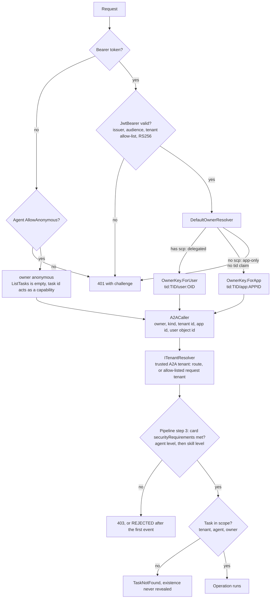

- **Owner keys.** App-only token: `tid:{tid}/app:{appid}`. Delegated token: `tid:{tid}/user:{oid}`. Built with `OwnerKey.ForApp` and `OwnerKey.ForUser`. The string format is frozen at 1.0, because every stored task holds it (B7) [07], [05].
- **Anonymous** is off by default. In Development with no auth scheme registered, agents with no access mode run anonymous, with one warning each (C8). In other environments, an agent that needs auth with no scheme registered fails startup.
- **Transports authenticate, the pipeline authorizes.** Transports build the principal and `A2ACaller`. Agent-level and skill-level checks run in the `IA2AMiddleware` pipeline (step 3) [07], [09].
- **Rate-limit key** uses the same token claims as `OwnerKey`, read before the body, so it needs no `A2ACaller`. Anonymous requests use the client IP [09], [07].
- **Card is the source of truth.** Requirements are OR across the list and AND within one requirement. Startup fails if a requirement names a scheme without an evaluator [07].
- **Tenant isolation.** The A2A tenant (routing tenant) is not the Entra `tid`. Every store key holds the tenant [07], [05].

`AUTH_REQUIRED` step-up with a grant (B6):

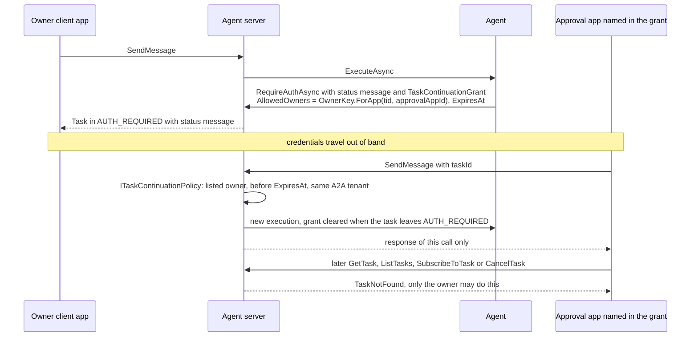

Reduced caller and pod-to-pod auth (B8, C6):

- A task stores a reduced caller (`StoredCaller`): owner key, Entra tenant id, app id, user object id, roles and scopes. It never stores a token.
- Runs on another pod and recovered runs rebuild `A2ACaller` from it, with `AccessToken = null`. On-behalf-of works only on the pod that received the request, during that request's run.
- Forwarded calls carry `ClusterCallContext` with the reduced caller and no raw token. The receiving pod already ran every check (B5).
- Pods authenticate to each other with Entra workload identity tokens that need the app role `A2A.Cluster.Peer`. `SharedKey` exists only in test code [06].
- `A2AAgentTool` calls remote agents with the agent's app identity by default. OBO is opt-in. It refuses task ids it did not create for the parent caller's owner (B9) [11].

Signing and verification [04], [08]:

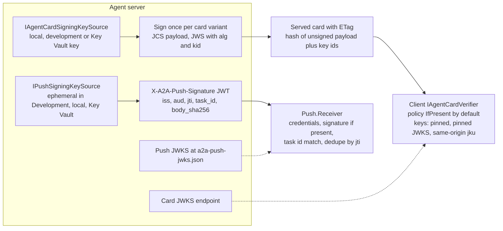

- Card signing follows spec 8.4 with RFC 8785 (JCS). Allowed algorithms: ES256 (default), ES384, PS256, RS256. Expired keys are skipped [04].
- The client verifies by policy `Off`, `IfPresent` (default) or `Required`. Known canonicalization variants of other SDKs are accepted with a warning until A2A #2122 is settled (C4) [04].
- A `jku` is trusted only on the same origin as the card. Keys are never fetched from an arbitrary `jku` [04].
- The push signature extension URI is `https://github.com/roman-ambinder/a2a-starter/extensions/push-signature/v1`. Package 01 owns it, and it changes if the repo moves before 1.0 [01], [08].
- Push always sends the spec-standard `Authorization` and token headers. The signature is an optional A2A extension. It is on when a key source is configured, and in Development (C9) [08].
- The receiver takes the JWKS location only from trusted agents. It checks the signature when one is present [08].
- Key Vault keys never leave the vault. A new key version is published before it signs (`PublishLead`), and an old one stays published for `RetireGrace` [04].
- Push credentials are protected at rest through `IPushCredentialProtector`. Outbox rows never hold credentials [08].
- Tokens, assertions and `Authorization` values never appear in logs, traces, stores or exception messages [07].

## 9. Key decisions

"Owner" means the owner decided. "Claude" means Claude's call, recorded in the work plan [00].

| Decision | Why, in a few words | Who | Spec |
|---|---|---|---|
| Keep and grow this SDK; do not fork the official `a2a-dotnet` | The official SDK is still preview and in-memory only | Owner | [00] |
| IDs and namespaces `Ambinder.A2A.*` | The NuGet ID `A2A` belongs to the official SDK | Owner | [00], [01] |
| Target .NET 10 only | Not stated | Owner | [00] |
| Public on nuget.org, Apache 2.0, reserved `Ambinder` prefix | Open-source SDK | Owner | [00], [01] |
| Abstract store; in-memory, EF Core and Cosmos in v1, one conformance suite | Durable stores without each team writing one | Owner | [05] |
| EF Core: PostgreSQL first, SQLite for dev, SQL Server tested less | Not stated | Claude | [05] |
| Multi-instance by HTTP owner-pod forwarding; Redis later | No Redis or message bus needed | Owner | [06] |
| Entra ID is the only shipped auth | Other schemes plug in | Owner | [07] |
| Owner key: tenant plus app, or tenant plus user; anonymous off | Users of one app must not share tasks | Claude | [07] |
| 0.3 compat ships in 1.0 GA | Owner moved it up because of the evidence | Owner | [15] |
| Missing `A2A-Version` means 0.3, answered `VersionNotSupported` until compat | Spec 3.6: empty header is 0.3 | Claude | [03] |
| Spec A2A v1.0.1; proto pinned to the `v1.0.1` tag | A fixed target, drift check in CI | Owner | [03] |
| Milestones M1 (single instance) and M2 (scale-out) | Early teams first | Claude | [00] |
| O1: repo stays at `roman-ambinder/a2a-starter` | Package URLs use it | Owner | [01] |
| O2: one builder; automated gates plus owner release approval | No second reviewer | Owner | [01], [02] |
| O3: no cloud resources yet; live tests skip visibly | Fakes, emulator and `kind` meet exit criteria | Owner | [00] |
| O4: previews unsigned; Trusted Signing before 1.0.0 | Owner action needed first | Owner | [01] |
| O5: author and copyright Roman Ambinder | Package metadata | Owner | [01] |
| C1: High or Critical advisories fail a PR; Windows tests nightly | New low advisories never block PRs | Claude | [01], [12] |
| C2: latest minor supported, previous minor gets security fixes for 3 months | Support window | Claude | [02] |
| C3: only TCK-bug SHOULD failures may go on the known-issues list | MUST failures never hidden | Claude | [03] |
| C4: card verify `IfPresent`, accept known canonicalization variants | A2A #2122 is open | Claude | [04] |
| C5: 30-day retention, Cosmos key (tenant, agent, owner), messageId dedupe on | Data minimization, single-partition lists, safe retries | Claude | [05] |
| C6: pod auth ships Entra workload identity only, in `Cluster.Entra` | No Azure in `Cluster`; `SharedKey` test-only | Claude | [06], [01] |
| C7: continuation affinity `PreferPreviousRunner`; interrupted streams resubscribe | Agents keep pod-local state | Claude | [06] |
| C8: OBO checked by fake authority and manual device code; Dev-only anonymous | No user sign-in in CI | Claude | [07] |
| C9: push signature on with a key source or in Dev; receiver verifies when present | No silent per-pod keys | Claude | [08] |
| C10: Gateway API sample ingress; 200 runs per pod; recovery `Fail`, `Restart(1)` opt-in | Portable ingress; re-runs only for idempotent agents | Claude | [09] |
| C11: `AllowSendRetry` and `CancelRemoteOnCallerCancel` default false | Other servers may not dedupe; a caller cancel is often a shutdown | Claude | [10] |
| C12: Agent Framework bridge in 1.0, preview if its library is not GA | Dependency maturity | Claude | [11], [01] |
| C13: MockEntra repo-only; `tck` and `interop` advisory for 2 weeks; 12 is size L | Teams use `TestIdentity` | Claude | [12] |
| C14: 0.3 split into `Compat.V0_3` and `Compat.V0_3.AspNetCore` | Client-only apps skip ASP.NET Core | Claude | [15], [01] |
| C15: `interop-smoke` on every PR, `interop-full` nightly and before release | Fast PRs, full matrix before shipping | Claude | [16] |
| B1: M1 single replica with `Recreate`; rolling restart test in M2 | Scale-out needs the cluster layer | Claude | [09], [06] |
| B2: internal test-harness slice in M1; no fixed ports or sleeps | 05 and 09 need it early | Claude | [12] |
| B3: cluster mode is EF Core only in 1.0; Cosmos fails fast | Cosmos cluster support after 1.0 | Claude | [06], [05] |
| B4: released tasks found by `ListReleasedAsync`, swept after one lease length | One recovery rule for 06 and 09 | Claude | [05], [06], [09] |
| B5: full middleware runs only on the receiving pod | Every check runs once, none skipped | Claude | [06], [09] |
| B6: grant holder gets its own response, nothing more | Step-up is single-use | Claude | [07], [10], [11] |
| B7: typed `OwnerKey`; format frozen at 1.0 | Stored in every row | Claude | [07], [05] |
| B8: reduced caller across pods and recovery, no token | Tokens never stored | Claude | [07], [05], [06] |
| B9: `A2AAgentTool` uses app identity, binds ids to the owner | Prompt-injection guard | Claude | [11] |
| B10: push-wait types in Client; OBO takes an assertion delegate | Receiver and client need no Server reference | Claude | [08], [10], [07] |
| B11: extended card cached per credential identity | The server filters it by caller | Claude | [10], [07] |
| B12: shared helpers as linked internal source; typed `A2AJson` accessors | No `InternalsVisibleTo` | Claude | [01], [02], [14] |
| B13: card ETag = hash of unsigned canonical payload plus key ids | Same ETag on every pod and after re-signing | Claude | [03], [04] |

Who made the 46 decisions in this table:

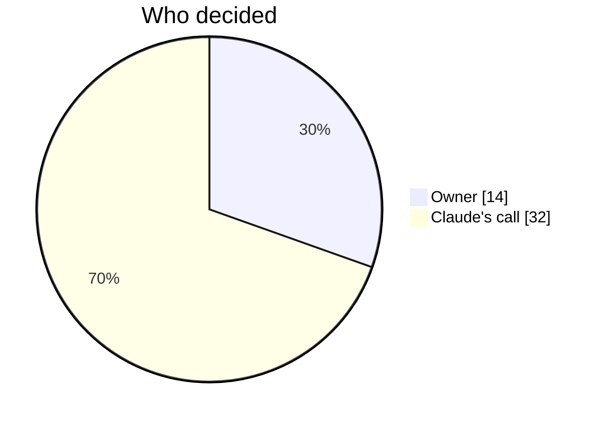

## 10. Resolved during architecture review

Nine points where the specs disagreed or were silent. Each was settled as Claude's call and written into the spec named below.

1. Agent-level and skill-level security checks run in the `IA2AMiddleware` pipeline (step 3). Transports only authenticate and never authorize: [07], [09].
2. The rate-limit key is computed in ASP.NET Core before the body is read, from token claims only (tenant id plus app id or user object id). Anonymous requests use the client IP: [09], [07].
3. Requests rejected before the pipeline get no `a2a.server` span, only the ASP.NET Core request span with `error.type`: [03], [09].
4. The task state transition table, with who may trigger each transition, lives in [03] (D13), and is referenced from [11] and [02].
5. The SDK ships no OTLP collector. The optional `overlays/otel/` sets `OTEL_EXPORTER_OTLP_ENDPOINT`: [09], [13].
6. The Data Protection key ring is not needed in M1. In M2 the cluster overlay shares one (Blob Storage plus a Key Vault key): [09], [08].
7. The headless Service is optional, used only with the DNS-based internal address template: [06].
8. The push signature extension URI is `https://github.com/roman-ambinder/a2a-starter/extensions/push-signature/v1`: [01], [08].
9. `Ambinder.A2A.Testing` depends on Server, Client, Protocol and AspNetCore: [01], [12].

[00]: ../superpowers/specs/2026-11-03-sdk-00-work-plan.md
[01]: ../superpowers/specs/2026-11-03-sdk-01-packaging-release-design.md
[02]: ../superpowers/specs/2026-11-03-sdk-02-public-api-design.md
[03]: ../superpowers/specs/2026-11-03-sdk-03-spec-conformance-design.md
[04]: ../superpowers/specs/2026-11-03-sdk-04-card-signing-design.md
[05]: ../superpowers/specs/2026-11-03-sdk-05-stores-design.md
[06]: ../superpowers/specs/2026-11-03-sdk-06-cluster-design.md
[07]: ../superpowers/specs/2026-11-03-sdk-07-security-entra-design.md
[08]: ../superpowers/specs/2026-11-03-sdk-08-push-design.md
[09]: ../superpowers/specs/2026-11-03-sdk-09-hosting-design.md
[10]: ../superpowers/specs/2026-11-03-sdk-10-client-design.md
[11]: ../superpowers/specs/2026-11-03-sdk-11-authoring-ai-design.md
[12]: ../superpowers/specs/2026-11-03-sdk-12-testing-quality-design.md
[13]: ../superpowers/specs/2026-11-03-sdk-13-docs-design.md
[14]: ../superpowers/specs/2026-11-03-sdk-14-performance-design.md
[15]: ../superpowers/specs/2026-11-03-sdk-15-compat-v03-design.md
[16]: ../superpowers/specs/2026-11-03-sdk-16-interop-design.md
