# Flows

One sequence diagram per flow. Each flow lists where the agent code is, the console command and the test.

Shorthand: `Client` is `samples/AgentClient` (library `src/A2A.Client`), `Server` is `samples/AgentServer` (library `src/A2A.Server`). Every request carries `A2A-Version: 1.0` unless noted. Run any command with `dotnet run --project samples/AgentClient -- <command>` after `./run-all.sh`. Back to the [README](../README.md).

The task manager is `src/A2A.Server/Tasks/TaskManager.cs`. The three transports are in `src/A2A.Server/Transports/` (`JsonRpc`, `Rest`, `Grpc`). Client flows are in `samples/AgentClient/FlowRunner.Basics.cs` and `FlowRunner.Advanced.cs`.

## 1. Discovery

Cards are public and need no version header or credentials. The root card is the `report` agent.

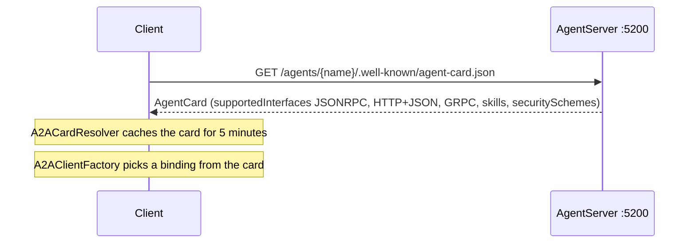

- Agent code: `samples/AgentServer/Cards/AgentCards.cs`
- Command: `discover`
- Tests: `DiscoveryAndAuthTests` (`Cards_match_agent_table`, `Card_security_matches_config`)

## 2. Send (blocking)

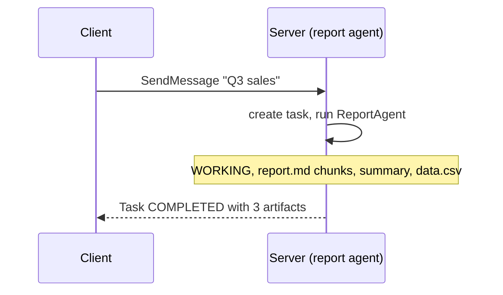

The call waits for a terminal state (`COMPLETED`, `FAILED`, `CANCELED`, `REJECTED`) or an interrupted state (`INPUT_REQUIRED`, `AUTH_REQUIRED`). The `echo` agent answers with a single `Message` and no task instead.

- Agent code: `samples/AgentServer/Agents/ReportAgent.cs`, `EchoAgent.cs`
- Command: `send`
- Tests: `ReportFlowTests.Report_blocking_send_returns_completed_with_three_artifacts`, `EchoFlowTests`

## 3. Stream

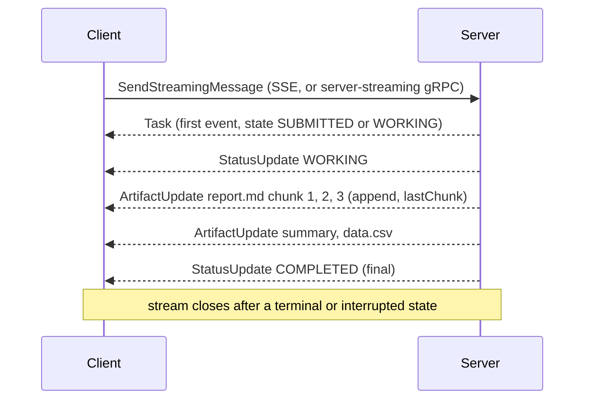

- Agent code: `ReportAgent.cs` (`sink.AddArtifactAsync(..., append, lastChunk, ct)`), SSE in `src/A2A.Server/Transports/Sse/`
- Command: `stream`
- Test: `ReportFlowTests.Report_stream_emits_working_chunks_and_completed_in_order`

## 4. Get and list

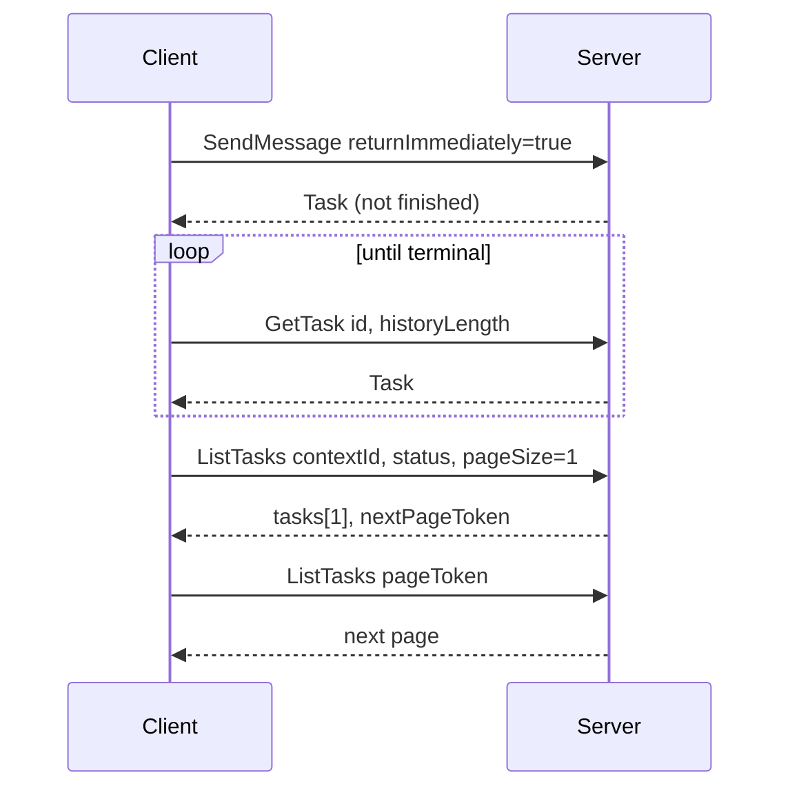

`historyLength` 0 returns no history, unset returns all. `ListTasks` sorts by status timestamp (newest first), defaults to 50 per page (1 to 100) and only returns the caller's tasks.

- Code: `src/A2A.Server/Tasks/TaskManager.cs`, `InMemoryTaskStore.cs` (`ITaskStore.ListAsync`)
- Commands: `get`, `list`
- Tests: `ReportFlowTests.Report_return_immediately_then_get_task_until_completed`, `Report_list_tasks_filters_by_context_and_status`

## 5. Cancel

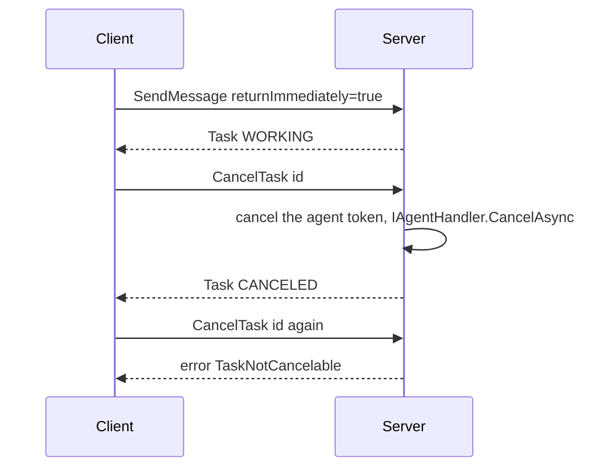

A cancel on a finished task returns `TaskNotCancelable`. A fast agent may finish first; the console flow reports that, it is not a failure.

- Agent code: `ReportAgent.cs` (stops quietly on cancel), default `CancelAsync` in `src/A2A.Server/Agents/IAgentHandler.cs`
- Command: `cancel`
- Tests: `ReportCancelFlowTests.Report_cancel_mid_task_ends_canceled`, `ReportFlowTests.Report_cancel_completed_task_not_cancelable`

## 6. Resubscribe

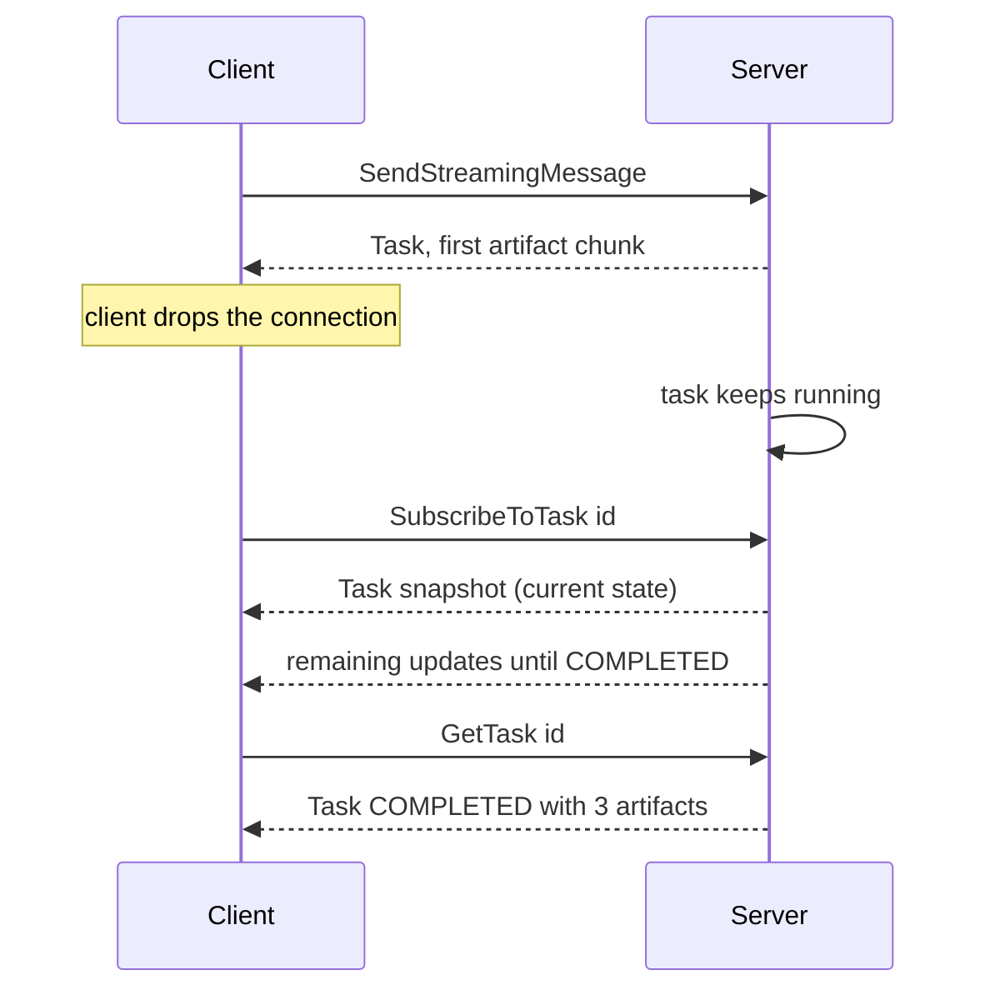

Subscribing to a task that is already terminal is refused with `UnsupportedOperation`.

- Code: `src/A2A.Server/Tasks/TaskEventBroker.cs`, `TaskManager.cs`
- Command: `resubscribe`
- Test: `ResubscribeTests.Resubscribe_after_disconnect_receives_terminal_event`

## 7. Multi-turn

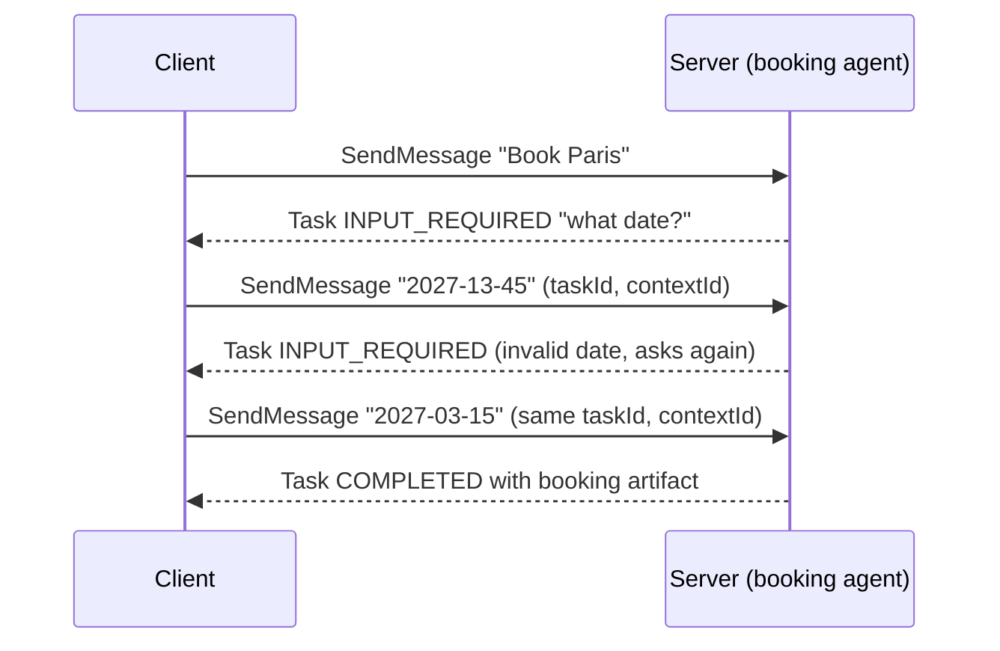

The agent object lives for one execution only, so `BookingAgent` reads the city back from the stored task history.

- Agent code: `samples/AgentServer/Agents/BookingAgent.cs`
- Command: `multi-turn`
- Test: `BookingFlowTests.Booking_multi_turn_completes_on_same_task_and_context`

## 8. Auth-required step-up

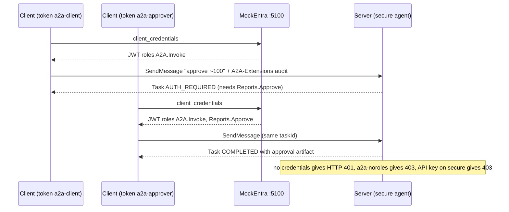

- Agent code: `samples/AgentServer/Agents/SecureAgent.cs`, policies in `samples/AgentServer/Auth/AuthSetup.cs`
- Command: `auth`
- Tests: `SecureFlowTests.Secure_client_token_pauses_auth_required`, `Secure_approver_token_resumes_and_completes`, `DiscoveryAndAuthTests` (401 and 403 cases)

## 9. Push notifications

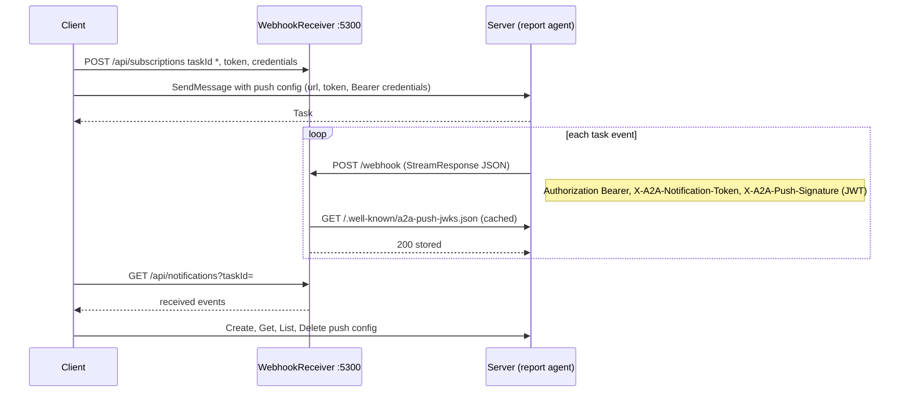

The receiver checks credentials, token, JWT signature (`aud`, `body_sha256`, `task_id`) and lifetime. A failed check returns 401 and stores nothing. See the [WebhookReceiver README](../samples/WebhookReceiver/README.md).

- Code: `src/A2A.Server/Push/PushNotificationSender.cs`, `PushSigningKey.cs`, `samples/WebhookReceiver/`
- Command: `push`
- Tests: `PushFlowTests.Report_push_delivers_all_events_to_receiver`, `Push_config_crud_over_each_transport`, `ReceiverVerificationTests`

## 10. Extended card

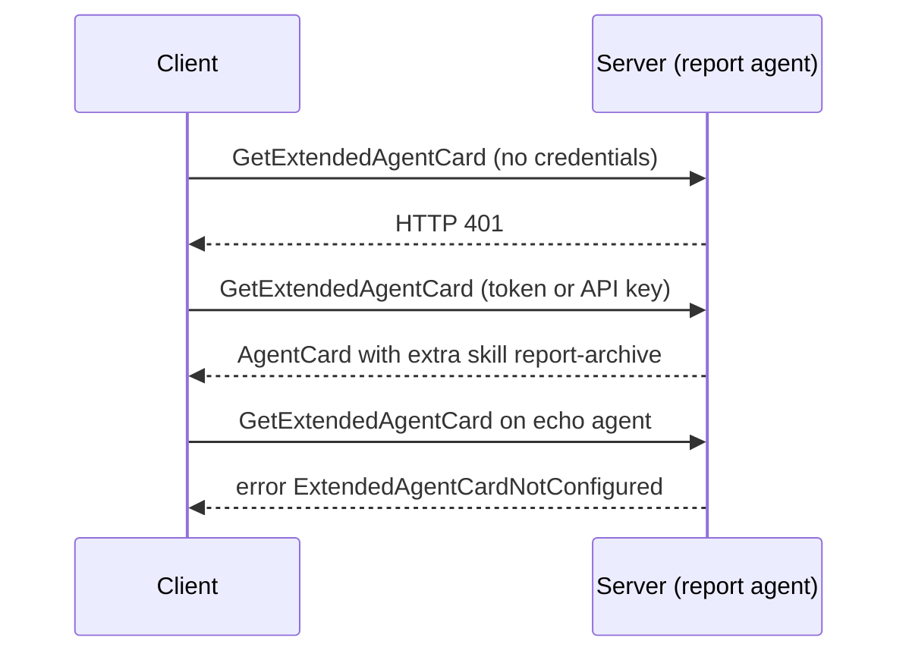

- Code: `samples/AgentServer/Cards/AgentCards.cs` (`HasExtendedCard`), `src/A2A.Server/Hosting/AgentCardEndpoints.cs`
- Command: `extended-card`
- Tests: `DiscoveryAndAuthTests.Extended_card_requires_auth_and_adds_skills`, `Echo_extended_card_not_configured`

## 11. Extensions

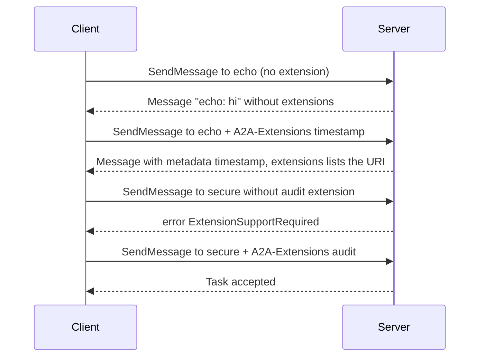

Only extensions that the card declares become active (`AgentRequestContext.ActiveExtensions`). An extension marked `required` on the card must be requested.

- Agent code: `samples/AgentServer/Agents/EchoAgent.cs`, `SecureAgent.cs`
- Command: `extensions`
- Tests: `EchoFlowTests.Echo_timestamp_extension_adds_metadata_only_when_requested`, `SecureFlowTests.Secure_without_audit_extension_fails_extension_required`

## 12. Errors

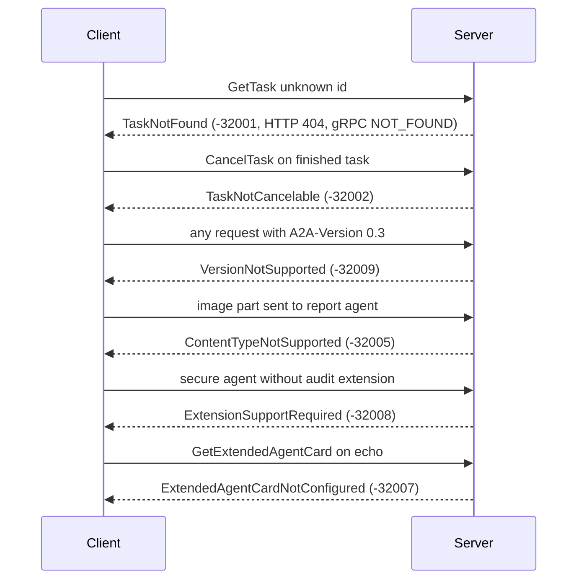

The same error maps to a JSON-RPC code, an HTTP status and a gRPC status with `ErrorInfo` (domain `a2a-protocol.org`). Auth failures are not A2A errors: they are HTTP 401 or 403 (gRPC `UNAUTHENTICATED` or `PERMISSION_DENIED`). The client throws `A2AException` for protocol errors and `A2AAuthException` for 401 and 403.

- Code: `src/A2A.Protocol/Errors/`, `src/A2A.Server/Transports/TransportErrors.cs`, `Grpc/GrpcErrorMapper.cs`, `Rest/RestErrorWriter.cs`
- Command: `errors`
- Tests: `ReportFlowTests` (`Report_rejects_image_input_with_content_type_not_supported`), `SecureFlowTests`, `EchoFlowTests`, and all of them together in `ConsoleFlowRunnerTests.All_flows_pass_against_test_host`
